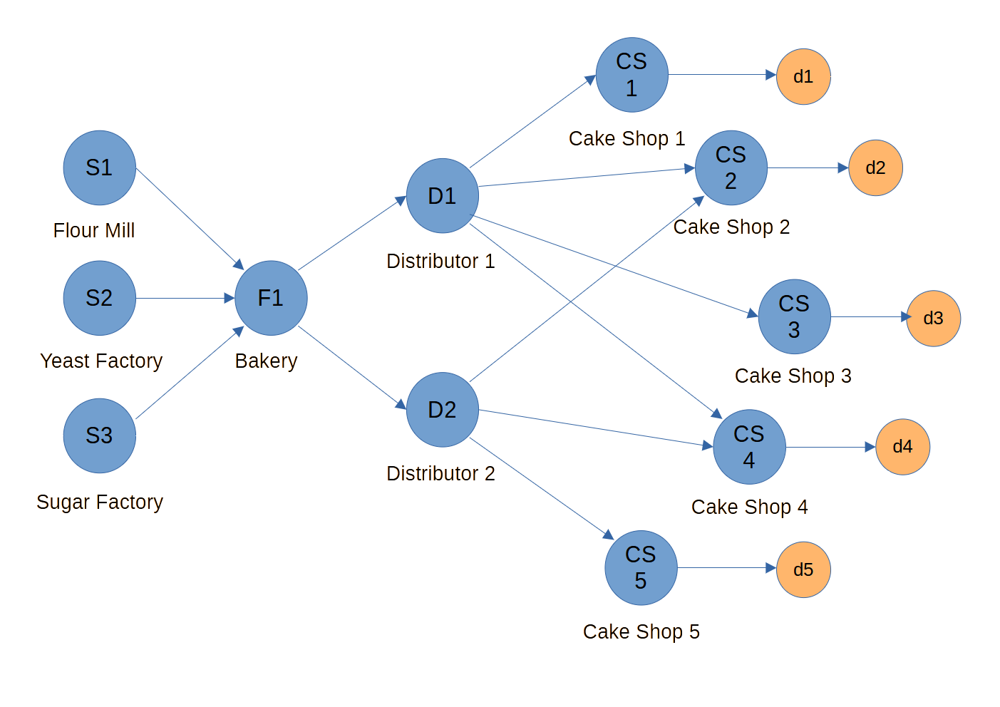

# Complex Supply Chain Network

This example shows how to build and simulate a larger supply chain in **SupplyNetPy**, with several levels and with retailers that can order from more than one distributor, using a mix of replenishment policies. Three raw-material suppliers (a flour mill, a yeast factory and a sugar factory) supply a manufacturer (a bakery), the bakery supplies two distributors, and the distributors supply five retailers (cake shops). In the picture, cake shops 2 and 4 can order from either distributor.



## Goals

* Create a network with several raw materials, three raw-material suppliers, a manufacturer, two distributors and five retailers.
* Mix replenishment policies ((s, S), (R, Q) and periodic).
* Let some retailers order from either of two distributors.

## Key Concepts Used

* **Products and raw materials.** The class `Product` creates the product, bread. `RawMaterial` creates the raw materials (flour, sugar and yeast).
* **Nodes.** The classes `Supplier`, `Manufacturer` and `InventoryNode` create the raw-material suppliers (infinite suppliers here), the bakery (a manufacturer), the distributors and the retailers (cake shops).
* **Links.** The class `Link` connects the sites.
* **Replenishment policies.**
    * `SSReplenishment`. When the inventory position falls to **s** or below, order enough to bring it back up to **S**.
    * `RQReplenishment`. When the inventory position falls to the reorder point **R** or below, order a fixed **Q** units.
    * `PeriodicReplenishment`. Every **T** time units, order **Q** units.
* **Supplier selection.** Each cake shop chooses between its suppliers with `SelectFirst` or `SelectAvailable`.
* **Perishable goods.** Every site that holds bread has `inventory_type` set to `perishable`, with a `shelf_life` of 5 time units.

## Full Example

> This script builds the network with two distributors and five retailers, then simulates it for 365 time units.

```python

```

## Sample Output

```

```


## Suggested Experiments

* Change the `policy_param` values (s and S, R and Q, T and Q).
* Change the lead times and the link costs.
* Change a retailer's `inventory_type` and `shelf_life` to study perishable goods.
* Add or remove links between the distributors and the cake shops to test resilience.

## Notes

* Keep node IDs unique.
* Make sure each `product_buy_price` is no more than its supplier's `product_sell_price`, where that applies.
* Use the same time unit for manufacturing times, lead times and review periods.
