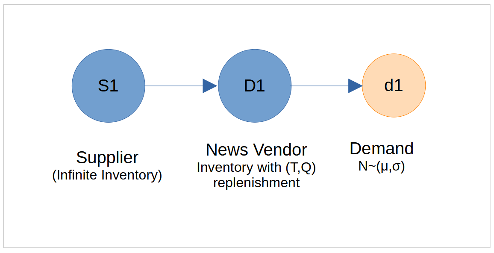
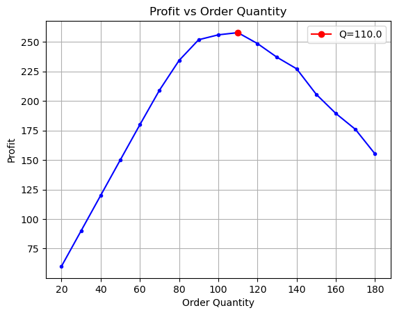

<style>
    img{
        width:70%;
    }
</style>

# News Vendor Problem

Imagine a newspaper vendor who buys copies wholesale every morning and sells them through the day. Demand is uncertain, as some days are busy and some quiet. If the vendor buys too few copies, they miss out on sales (and on the profit those sales would have brought in). If they buy too many, the leftover papers are wasted at the end of the day, since yesterday's news doesn't sell tomorrow. **How many copies should the vendor buy?** That is the **newsvendor problem**, finding the order quantity that, on average, gives the highest profit when you weigh the cost of running out against the cost of leftovers. The same balance shows up for any perishable product with unpredictable demand, such as fresh produce, baked goods, daily prepared meals, magazines and flowers.

## Problem Definition

The newsvendor orders Q units every day. Each unit costs c, and the sell price is p. The newsvendor faces normally distributed demand with mean &mu; and standard deviation &sigma;. If, on a certain day, the actual demand is k, then the net profit after selling k units is

<span>
    <strong>Profit</strong> = <strong>Revenue</strong> &minus; <strong>Order Cost</strong> = <em>k</em> &times; <em>p</em> &minus; <em>Q</em> &times; <em>c</em>
</span>

However, any units left unsold at the end of the day are wasted, since they cannot be sold the next day. The newsvendor can sell these unsold units back to the supplier at a lower price, called the salvage value s. If the actual demand that day is less than the order size Q, then the net profit is

<span>
    <strong>Profit</strong> = <strong>Revenue</strong> + <strong>Salvage</strong> &minus; <strong>Order Cost</strong> = <em>k</em> &times; <em>p</em> + (<em>Q</em> &minus; <em>k</em>) &times; <em>s</em> &minus; <em>Q</em> &times; <em>c</em>
</span>

When the actual demand <em>k</em> is more than the newsvendor's order quantity <em>Q</em>, the profit is

<span>
    <strong>Profit</strong> = <em>Q</em> &times; <em>p</em> &minus; <em>Q</em> &times; <em>c</em>
</span> 
&emsp; &emsp; (In this case, all available units are sold, and the profit is the revenue from selling <em>Q</em> units minus the total ordering cost.)

So, the newsvendor problem is defined by the following parameters.

* **Ordering cost (c).** Cost per unit ordered.
* **Sell price (p).** Price per unit sold.
* **Salvage value (s).** Value per unsold unit at the end of the period.
* **Mean demand (&mu;).** Average demand during the period.
* **Standard deviation of demand (&sigma;).** How much the demand varies.
* **Number of samples (n).** Number of demand samples for the simulation.
* **Order quantity (Q).** Units ordered for the period.

The objective is to find the order quantity Q<sup>*</sup> that maximizes the expected profit.

## Analytical Solution

The optimal order quantity is

<span>
    Q<sup>*</sup> = &mu; + &sigma; &middot; &Phi;<sup>&minus;1</sup>
    (<span style="vertical-align:middle;">C<sub>u</sub> / (C<sub>u</sub> + C<sub>o</sub>)</span>)
</span>

where

* C<sub>u</sub> = p &minus; c is the underage cost (profit lost per unit of demand that could not be met),
* C<sub>o</sub> = c &minus; s is the overage cost (cost per unsold unit),
* &Phi;<sup>&minus;1</sup> is the inverse of the standard normal distribution, and
* C<sub>u</sub>/(C<sub>u</sub> + C<sub>o</sub>) is the critical ratio (the share of demand to satisfy).

## Example Parameters

The parameters in this example are<br>
  c = 2<br>
  p = 5<br>
  s = 1<br>
  &mu; = 100<br>
  &sigma; = 15<br>
  n = 1000<br>
  Q = 100 (example order quantity)<br>

Putting in the values<br>
C<sub>u</sub> = 5 &minus; 2 = 3<br>
C<sub>o</sub> = 2 &minus; 1 = 1<br>
Critical ratio = 3/(3 + 1) = 0.75<br>
Q<sup>*</sup> = 100 + 15 &middot; &Phi;<sup>&minus;1</sup>(0.75)<br>
Q<sup>*</sup> &approx; 100 + 15 &middot; 0.6745 = 110.12<br>
So, the optimal order quantity is about **110 units**.<br>

## Modeling and Simulating the Newsvendor Problem

It is a simple supply chain with three nodes, an infinite supplier, the newsvendor (a retailer), and a customer demand at the newsvendor with normally distributed order sizes. One time unit is read as one day.



**Simulation Setup**

* An *infinite\_supplier* gives the newsvendor an unlimited supply.
* The simulation focuses on the newsvendor, `newsvendor1`, which
    * keeps a perishable inventory with a shelf life of 1 day, and
    * uses a periodic replenishment policy, placing a replenishment order every day.
* The link between the supplier and the newsvendor has a lead time of 0, so each day's order arrives at once.
* The customer demand places one customer order a day, with an order size drawn from a normal distribution by the `normal_quantity()` function.
* With `consume_available` set to True, a customer whose order cannot be filled in full takes the units that are there. This is needed because the simulation represents the whole day's demand as a single customer order, while in reality many customers each buy a newspaper.
* After the run, the profit is worked out from the units sold, the expired units (sold back at the salvage value) and the ordering cost.


```python

```

The following plot shows how the profit changes with the order quantity (Q). The highest profit is reached when Q is about 110, which confirms the analytical solution for the optimal order quantity.




## Takeaway

This example showed how to solve the newsvendor problem by simulation with the SupplyNetPy library. By simulating different order quantities and comparing the resulting profits, we can see and confirm the order quantity that maximizes the expected profit. This approach can be extended to more complex inventory scenarios and demand distributions, giving useful insights for inventory decisions.
