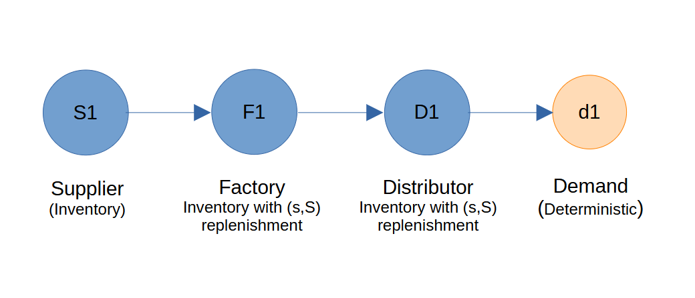

# Supply Chain With a Manufacturer

This example shows how to create a complete supply chain with a raw-material supplier, a manufacturer, a distributor and a customer demand.



## Creating Nodes

In this scenario, we create a raw-material supplier with finite inventory. A raw-material supplier with finite inventory needs a raw material, which is created first. The raw material is defined by its ID, its name, how many units are mined in each round of mining (`extraction_quantity`), how long each round takes (`extraction_time`), the mining cost per unit, and the sell price per unit (`cost`). The raw-material supplier mines a single raw material. It mines whenever its inventory is not full, and starts again as soon as its inventory drops.

```python

```

Creating a manufacturer requires a product. The product, the manufacturer and the distributor are created below. In the code, the manufacturer has the node type `"factory"`, which means the same as `"manufacturer"`.

```python

```

The manufacturer plans its production with a replenishment policy, here an (s, S) policy. When the inventory position of its product falls to s (1000) or below, it plans enough production to bring the inventory position back up to S (2500), and orders the raw materials needed. Each unit of the product needs 2 units of the raw material. The manufacturer makes the planned units in production batches of at most 1000 units, each taking 1 time unit. The distributor also follows an (s, S) policy, with s = 300 and S = 1000.

## Defining Links

Links carry units from one site to another, each with its own transportation cost and lead time.

```python

```

## Modeling Demand

The customer demand is at the distributor, with a customer order of 30 units every 0.4 time units (fixed, with no randomness).


```python

```

## Running the Simulation

Create the supply chain network and simulate it.

```python

```

## Review Results

Here is the simulation log produced by the network.

<div id="" style="overflow:scroll; height:600px;">
```

```
</div>
