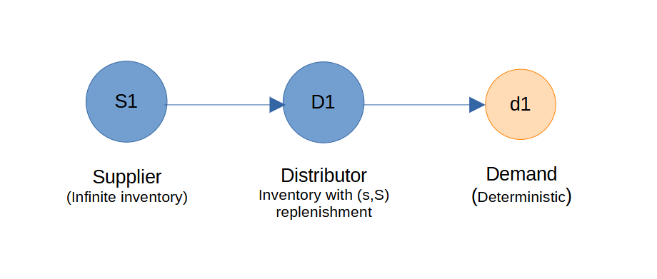

# SupplyNetPy in 10 Minutes

## Installation

SupplyNetPy can be installed using pip.

```sh
pip install supplynetpy
```

## Quick Start, Building a Simple Supply Chain with Three Nodes

Follow these steps to create and simulate a basic supply chain with an infinite supplier, a distributor and a customer demand.



### Import the Library

```python
import SupplyNetPy.Components as scm
```

The `Components` module gives you the building blocks of a supply chain. These are the nodes (raw-material suppliers, manufacturers, distributors, warehouses and retailers), products and inventories, customer demands, and the links that connect them. You assemble them into a model that fits your scenario. The words used on this page are explained in the [Glossary](glossary.md).

### Create Nodes

Let us create an infinite supplier, a supplier that never runs out and so can supply any number of units to its buyers. It needs an ID, a name and a node type. To make it an infinite supplier, set the node type to `infinite_supplier`.

```python

```

Next, a distributor that buys units from the supplier. Its settings include the ID, the name, the capacity, the replenishment policy and its parameters, and the buy and sell prices.

```python

```

For a manufacturer, distributor, warehouse or retailer, we give its replenishment policy (the rule it follows to decide when to place a replenishment order and how many units to order) and the policy's parameters.

The policies are subclasses of the `InventoryReplenishment` class, which you can also subclass to define your own. SupplyNetPy has the following replenishment policies.

* [The (s, S) policy](api-reference/api-ref-core.md#SupplyNetPy.Components.core.SSReplenishment). When the inventory position falls to s or below, order enough units to bring it back up to S. Parameters {s, S}, class `SSReplenishment`.

* [The (s, S) policy with a safety stock](api-reference/api-ref-core.md#SupplyNetPy.Components.core.SSReplenishment). The same, with the safety stock added to both s and S. Parameters {s, S, safety_stock}, class `SSReplenishment`.

* [The (R, Q) policy](api-reference/api-ref-core.md#SupplyNetPy.Components.core.RQReplenishment). When the inventory position falls to R or below, order a fixed Q units. Parameters {R, Q}, class `RQReplenishment`.

* [The periodic policy](api-reference/api-ref-core.md#SupplyNetPy.Components.core.PeriodicReplenishment). Every T time units, order Q units. Parameters {T, Q}, class `PeriodicReplenishment`.

* [The periodic policy with a safety stock](api-reference/api-ref-core.md#SupplyNetPy.Components.core.PeriodicReplenishment). The same, but if the inventory level is below the safety stock, the order also includes the units needed to bring it back up to the safety stock. Parameters {T, Q, safety_stock}, class `PeriodicReplenishment`.

The inventory position is the inventory level, plus the units in transit, minus the units still owed. By default, the (s, S) and (R, Q) policies check it each time the inventory drops.

### Create a Link

A link is created as shown below. Its settings include the transportation cost and the lead time. The lead time can be a number, or a function with no arguments that returns one lead time each time it is called, for example a random one drawn from a distribution of your choice. For a constant lead time, a Python `lambda` such as `lambda: 2` is enough.

```python

```

### Specify Demand

A customer demand is created by giving an ID, a name, the site the customers order from, how often orders arrive, and how many units each order is for. The "how often" and "how many" values are each given as a small function with no arguments that returns a number. If you want randomness, for example customer orders arriving at times drawn from an exponential distribution, write a function that samples from that distribution and returns one number per call. If you want a fixed value, just use a `lambda` such as `lambda: 1`. A customer demand can be at any site except a raw-material supplier, usually a retailer or a distributor. The example below sets up a steady demand of 10 units every time unit (read here as a day) at distributor D1.

```python

```

### Assemble and Simulate the Network

To create and simulate the supply chain, use the `create_sc_net` function to create the nodes and assemble them into a network. This function also records information about the network, such as the number of nodes, and returns a Python dictionary that holds all the parts of the network. The `simulate_sc_net` function then simulates the network up to a given time and writes a log of the run. It also calculates results for the whole network, such as profit and throughput. Let's use these functions to build and simulate our supply chain.

```python

```

### Review Results

After the simulation, look at `supplychainnet` to see the results. When `simulate_sc_net` runs with `logging=True` (the default), the simulation log is shown in the console and saved to a file named `simulation_trace.log` in the folder you run the script from. Each node has its own logger, and you can switch it on or off with `logging=True` or `logging=False` when you create the node. To switch all simulation logs on or off at once, call `scm.global_logger.enable_logging()` or `scm.global_logger.disable_logging()`.

**Repeating the same run.** Some parts of the simulation can be random, for example disruptions that start at random (`failure_p` on a node, and the similar settings on a `Link`). By default, every run draws different random numbers, so two runs in a row may give slightly different results. If you want to repeat *exactly the same run*, for instance to compare two policies under the same sequence of disruptions, call `scm.set_seed(n)` once before you build the network. For even finer control, you can also create your own random number generator with `random.Random()` and pass it as the `rng` argument when you create a node or a link. That node or link then uses its own random numbers, independent of the rest.

Below is an example of a simulation log from this program. At the end of the log, the results for the whole network are printed. They are added up from every node and include the following.

* Holding cost (`inventory_carry_cost`)
* What the sites paid for the units they received (`inventory_spend_cost`)
* Transportation cost
* Total cost
* Revenue
* Profit

What each result means is listed under `simulate_sc_net` in the [API reference](api-reference/api-ref-utilities.md).

<div id="" style="overflow:scroll; height:600px;">
```

```
</div>

To see the statistics of one node, call `node.stats.get_statistics()`. In this example, the statistics of node `D1` can be read with the code below.

```python

```
Here is the output produced by the code above.
```

```
---

## Another Approach, Creating the Objects Yourself

This approach builds and simulates the same supply chain by creating each node, link and customer demand as a Python object yourself, instead of passing dictionaries to the utility functions. This gives more flexibility. The simulation runs in a SimPy environment that you create, which makes it easy to combine with your own SimPy processes.

```python

```

This script produces the same simulation log, because the network and its demand are deterministic. The results for the whole network are not in the log, because they are calculated by the function `simulate_sc_net`. The statistics of each node are still available, as shown earlier. We can also create and simulate the supply chain network with the same functions, `create_sc_net` and `simulate_sc_net`, as shown below.

```python

```

Note that an extra parameter, `env`, is passed to `create_sc_net`. It is needed because we created the SimPy environment (`env`) ourselves, and the same environment must be used to create the supply chain network and to run the simulation.
